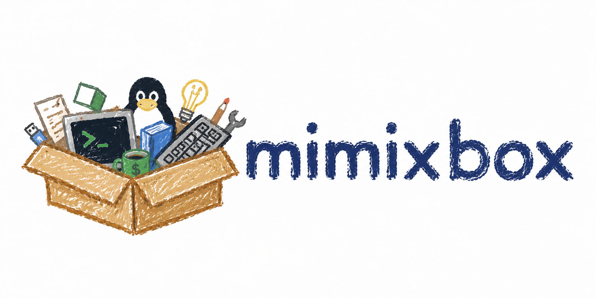

<!-- ALL-CONTRIBUTORS-BADGE:START - Do not remove or modify this section -->
[](#contributors-)
<!-- ALL-CONTRIBUTORS-BADGE:END -->
[](https://github.com/nao1215/mimixbox/actions/workflows/build.yml)
[](https://github.com/nao1215/mimixbox/actions/workflows/unit_test.yml)
[](https://github.com/nao1215/mimixbox/actions/workflows/integration_test.yml)

[](https://github.com/nao1215/mimixbox/actions/workflows/gitleaks.yml)
[](https://github.com/nao1215/mimixbox/actions/workflows/trivy.yml)
[](https://github.com/nao1215/mimixbox/actions/workflows/govulncheck.yml)
[](https://github.com/nao1215/mimixbox/actions/workflows/gosec.yml)
[](https://github.com/nao1215/mimixbox/actions/workflows/reviewdog.yml)
[](https://github.com/nao1215/atago)
[](https://github.com/nao1215/himorime)
[](https://github.com/nao1215/mimixbox/releases)
[](./LICENSE)
[](https://scorecard.dev/viewer/?uri=github.com/nao1215/mimixbox)



MimixBox packs over 450 Unix commands (applets) into one Linux binary, like BusyBox, but for the desktop instead of embedded systems. It covers Coreutils and much of BusyBox, and adds a few commands of its own.


Run an applet as `mimixbox APPLET ...`, or through a symlink named after it once installed:

```shell
$ mimixbox --list --filter=sha
  sha1sum - Calculate or Check secure hash 1 algorithm
sha256sum - Calculate or Check secure hash 256 algorithm
sha384sum - Calculate or Check secure hash 384 algorithm
  sha3sum - Calculate or Check SHA-3 message digest
sha512sum - Calculate or Check secure hash 512 algorithm
```

The full list with descriptions is in [doc/commands.md](https://github.com/nao1215/mimixbox/blob/main/doc/commands.md), and `mimixbox APPLET --help` shows an applet's options and examples.

## Install

MimixBox runs on Linux only. The [Release Page](https://github.com/nao1215/mimixbox/releases) has a `tar.gz` archive and `.deb`, `.rpm`, and `.apk` packages for `linux/amd64` and `linux/arm64`. The archive `mimixbox_<version>_linux_<arch>.tar.gz` contains the `mimixbox` binary, `LICENSE`, `README.md`, dependency licenses under `THIRD_PARTY_LICENSES/`, and `installer.sh` with its `libshell.sh` helper.

```shell
$ tar xf mimixbox_0.42.7_linux_amd64.tar.gz
$ cd mimixbox_0.42.7_linux_amd64
$ sudo ./installer.sh
```

The installer copies the binary to `/usr/local/bin` and creates a symlink there for each applet; it needs no Git checkout. To do it by hand:

```shell
$ sudo install -m 0755 mimixbox /usr/local/bin/
$ sudo mimixbox --install /usr/local/bin
```

### Use "go install"

Building from source needs Go 1.26.11 or later.

```shell
$ go install github.com/nao1215/mimixbox/cmd/mimixbox@latest
$ sudo mimixbox --install /usr/local/bin
```

### Use AUR (Arch Linux)

[mimixbox-bin](https://aur.archlinux.org/packages/mimixbox-bin), maintained by [Dominiquini](https://github.com/Dominiquini), installs the release binary.

```shell
$ yay -S mimixbox-bin
```

### Verifying release integrity

Since v0.42.4, each release has `checksums.txt` signed with [cosign](https://github.com/sigstore/cosign) (keyless, as `checksums.txt.sigstore.json`), an SPDX SBOM (`*.sbom.json`) per archive, and SLSA build provenance attested via GitHub OIDC and attached as `multiple.intoto.jsonl`.

Verify the signed checksums, then your download:

```shell
cosign verify-blob \
  --bundle checksums.txt.sigstore.json \
  --certificate-identity-regexp 'https://github.com/nao1215/mimixbox/\.github/workflows/release\.yml@refs/tags/.*' \
  --certificate-oidc-issuer 'https://token.actions.githubusercontent.com' \
  checksums.txt
sha256sum --check --ignore-missing checksums.txt
```

Verify the build provenance with the GitHub CLI:

```shell
gh attestation verify mimixbox_<version>_linux_<arch>.tar.gz --repo nao1215/mimixbox
```

Or with [slsa-verifier](https://github.com/slsa-framework/slsa-verifier) and the `multiple.intoto.jsonl` asset:

```shell
slsa-verifier verify-artifact mimixbox_<version>_linux_<arch>.tar.gz \
  --provenance-path multiple.intoto.jsonl \
  --source-uri github.com/nao1215/mimixbox \
  --source-tag v<version>
```

## Original commands

These commands are not in Coreutils or BusyBox.

fakemovie adds a movie-style play button to an image (based on [mattn's fakemovie](https://github.com/mattn/fakemovie)). `-o` sets the output name, `-p` picks another button style, and `-r` sets the radius.

```shell
$ fakemovie lena.png            # writes lena_fake.png
$ fakemovie -p lena.png -o out.png
```

ghrdc (GitHub Release Downloads Counter) prints how many times a repository's release assets were downloaded. `-a` shows the count per release and `-t` the total. It uses the unauthenticated GitHub API, so it works for public repositories only, at 60 calls per hour.

```shell
$ ghrdc nao1215/mimixbox        # latest release
$ ghrdc -t nao1215/mimixbox     # all releases (total)
```

path prints a path's absolute form, canonical form, directory, basename or extension.

```shell
$ path -a path                  # absolute path
$ path -b /etc/systemd/pstore.conf   # basename -> pstore.conf
$ path -d /etc/ssh/ssh_config        # dirname  -> /etc/ssh
$ path -e archive.tar.gz             # extension -> .gz
```

sddf (Search & Delete Duplicated File) finds files with the same md5 checksum and removes the duplicates, keeping the most recent copy. It writes the removed files to `duplicated-file.sddf` (change the name with `-o`).

```shell
$ sddf .
```

serial renames the files in a directory to one base name plus a serial number. `-n` sets the base name, `-p` (default) or `-s` puts the number before or after it, and `-d` previews the renames.

```shell
$ serial -n photo .             # photo0, photo1, ... in the current directory
$ serial -d -n photo .          # dry run: print the renames without applying them
```

## Testing

| Technique | Bug class caught here |
|---|---|
| [Unit tests](internal/applets) | An applet that writes the wrong output or exit status for an option |
| [End-to-end scenarios](e2e/atago) | The binary and its applet names behaving differently from the unit under test |
| [Differential tests against GNU coreutils](internal/applets/differential_test.go) | Output or exit status that differs from GNU coreutils on generated input |
| [Fuzzing](.github/workflows/fuzz.yml) | Panics and hangs in decoders and option parsers on malformed input |
| [Mutation testing](.github/workflows/mutation.yml) | Logic a change can break without a test failing |
| [himorime benchmarks](bench) | A pull request that makes an applet slower or larger in memory than its base |

Commands, mutation scores and the CI jobs are in [doc/testing.md](doc/testing.md).

## Development

| Tool | Description |
|:-----|:------|
| go-licenses | License management of dependent libraries |
| make | Build, test, release, etc. |
| install | Install the MimixBox binary on the system |
| docker | Test MimixBox inside Docker |
| debootstrap | Test MimixBox inside a jail environment |
| [atago](https://github.com/nao1215/atago) | End-to-end test |
| golangci-lint | Lint Go code |

On Debian-based distributions (Debian, Ubuntu, Kali Linux, Raspberry Pi OS):

```shell
$ sudo apt install build-essential curl git docker.io debootstrap
$ go install github.com/google/go-licenses/v2@latest
$ go install github.com/nao1215/atago@latest
```

### How to build

```shell
$ git clone https://github.com/nao1215/mimixbox.git
$ cd mimixbox
$ make build
```

### Debugging

Create a Docker environment:

```shell
$ make docker
# Once the image build finishes, you are inside the container.
```

Create a jail environment:

```shell
$ sudo apt install debootstrap            # If debootstrap is not installed on Ubuntu.
$ make build                              # Build the mimixbox binary.
$ sudo make jail                          # Create the jail at /tmp/mimixbox/jail.

$ sudo chroot /tmp/mimixbox/jail /bin/bash    # Dive into the jail.
# mimixbox --full-install /usr/local/bin      # Install MimixBox commands in the jail.
```

## Contributing

See [CONTRIBUTING.md](./CONTRIBUTING.md). A GitHub Star also helps keep the project going.

[](https://star-history.com/#nao1215/mimixbox&Date)

## Contact

Report bugs and request features in [GitHub Issue](https://github.com/nao1215/mimixbox/issues). Sponsorship is welcome.

## License

MimixBox is licensed under the [Apache License 2.0](./LICENSE). Some applets (for example `nc`, `whris`, and `fakemovie`) include third-party code under the MIT License; their copyright and license notices are kept in the source files.

The release archives and the `.deb` / `.rpm` / `.apk` packages include the license texts of every linked dependency under `THIRD_PARTY_LICENSES/` (installed to `/usr/share/doc/mimixbox/THIRD_PARTY_LICENSES`). The `fakemovie` applet renders text with Freetype-Go, which MimixBox uses under the FreeType License: portions of this software are based in part on the work of the FreeType Team (https://freetype.org/).

## Contributors

Thanks goes to these wonderful people ([emoji key](https://allcontributors.org/docs/en/emoji-key)):

<!-- ALL-CONTRIBUTORS-LIST:START - Do not remove or modify this section -->
<!-- prettier-ignore-start -->
<!-- markdownlint-disable -->
<table>
  <tbody>
    <tr>
      <td align="center" valign="top" width="14.28%"><a href="https://debimate.jp/"><br /><sub><b>CHIKAMATSU Naohiro</b></sub></a><br /><a href="https://github.com/nao1215/mimixbox/commits?author=nao1215" title="Code">💻</a></td>
      <td align="center" valign="top" width="14.28%"><a href="https://github.com/polynomialspace"><br /><sub><b>polynomialspace</b></sub></a><br /><a href="https://github.com/nao1215/mimixbox/commits?author=polynomialspace" title="Code">💻</a></td>
      <td align="center" valign="top" width="14.28%"><a href="https://github.com/k-avy"><br /><sub><b>Kavya Shukla</b></sub></a><br /><a href="https://github.com/nao1215/mimixbox/commits?author=k-avy" title="Code">💻</a></td>
      <td align="center" valign="top" width="14.28%"><a href="https://rafaeldominiquini.ddns.net/"><br /><sub><b>Rafael Baboni Dominiquini</b></sub></a><br /><a href="#platform-Dominiquini" title="Packaging/porting to new platform">📦</a></td>
    </tr>
  </tbody>
  <tfoot>
    <tr>
      <td align="center" size="13px" colspan="7">
        
          <a href="https://all-contributors.js.org/docs/en/bot/usage">Add your contributions</a>
        </img>
      </td>
    </tr>
  </tfoot>
</table>

<!-- markdownlint-restore -->
<!-- prettier-ignore-end -->

<!-- ALL-CONTRIBUTORS-LIST:END -->

This project follows the [all-contributors](https://github.com/all-contributors/all-contributors) specification. Contributions of any kind welcome!
